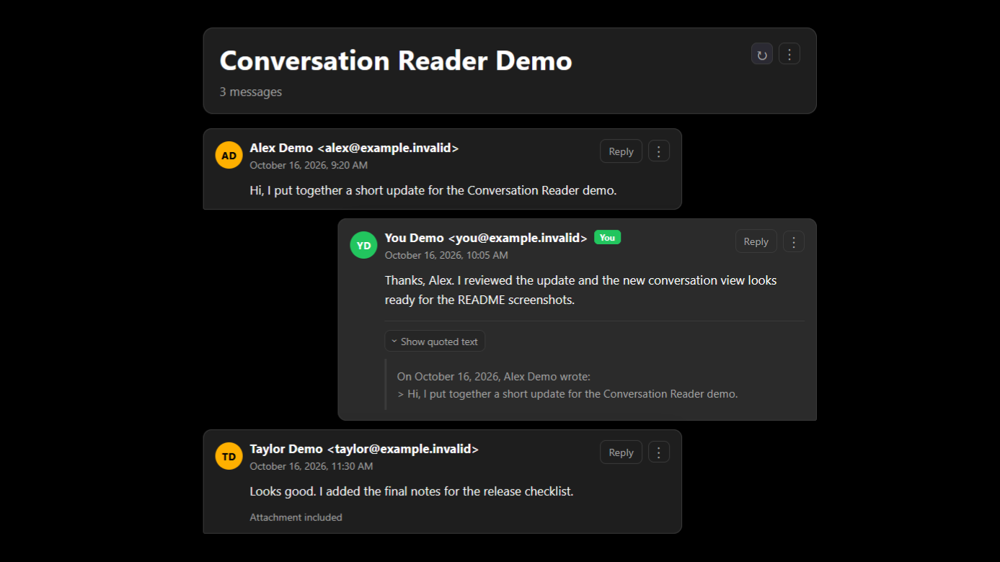

# Conversation Reader for Thunderbird



Conversation Reader for Thunderbird opens selected emails in a clean, chronological conversation view inside Thunderbird.

The screenshot uses dummy messages for demonstration.

## Features

- Open selected messages from the toolbar or inbox context menu.
- Group related replies into one conversation.
- Collapse quoted text and highlight your own messages.
- Reply to a message or open the original email.
- Export a conversation as Markdown.
- Choose a predefined accent color.

## Requirements

Thunderbird 137 or later.

## Development

This project uses TypeScript and Vite. Install the dependencies and build the extension:

```bash
bun install
bun run build
```

The generated extension is placed in `dist/`. Load `dist/manifest.json` as a temporary add-on in Thunderbird.

## License

MPL-2.0. See [LICENSE](LICENSE).
